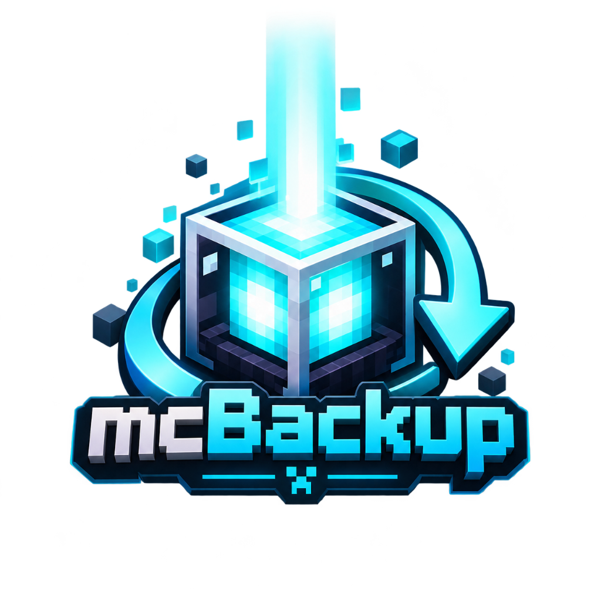

<a id="readme-top"></a>

[![Contributors][contributors-shield]][contributors-url]
[![Forks][forks-shield]][forks-url]
[![Stargazers][stars-shield]][stars-url]
[![Issues][issues-shield]][issues-url]
[![Release][release-shield]][release-url]

<br />
<div align="center">
  <a href="https://github.com/tex1ure/mcBackup">
    
  </a>

  <h3 align="center">mcBackup</h3>

  <p align="center">
    Automatic Minecraft world backups to Google Drive after every single Save &amp; Quit, exit, or PC shutdown.
    <br />
    <a href="https://github.com/tex1ure/mcBackup/releases"><strong>Download Latest Release »</strong></a>
    <br />
    <br />
    <a href="#getting-started">Getting Started</a>
    ·
    <a href="https://github.com/tex1ure/mcBackup/issues/new?labels=bug">Report Bug</a>
    ·
    <a href="https://github.com/tex1ure/mcBackup/issues/new?labels=enhancement">Request Feature</a>
  </p>
</div>

<details>
  <summary>Table of Contents</summary>
  <ol>
    <li>
      <a href="#about-the-project">About The Project</a>
      <ul>
        <li><a href="#built-with">Built With</a></li>
      </ul>
    </li>
    <li>
      <a href="#getting-started">Getting Started</a>
      <ul>
        <li><a href="#windows-single-file-installer">Windows</a></li>
        <li><a href="#macos-installer">macOS</a></li>
        <li><a href="#linux-installer">Linux</a></li>
      </ul>
    </li>
    <li><a href="#usage">Usage</a></li>
    <li><a href="#how-it-works">How It Works</a></li>
    <li><a href="#roadmap">Roadmap</a></li>
    <li><a href="#contributing">Contributing</a></li>
  </ol>
</details>

---

## About The Project

**mcBackup** watches your chosen Minecraft world(s) in the background and automatically creates a timestamped `.zip` archive and uploads it to your Google Drive every time you:

- Click **Save and Quit to Title**
- Close Minecraft (**Quit Game** / Alt+F4)
- Shut down or log off your computer (snapshots locally and auto-uploads on next boot)

### Key Features

- **Multi-Launcher World Auto-Discovery**: Automatically finds worlds from Vanilla `.minecraft`, PolyMC, PrismLauncher, MultiMC, Modrinth, CurseForge, Bedrock, and custom folders (reading `Data.LevelName` directly from `level.dat`).
- **Zero-Polling-Waste Lock Detection**: Uses OS-level `session.lock` checks (`CreateFileW` / `LockFileEx` on Windows, `flock` on macOS/Linux) so backups trigger only when you finish a play session.
- **Google Drive Sync & Retention**: Uploads via `rclone` with automatic pruning (keeps the latest **N** backups locally and in Drive, default `15`).
- **Offline Queue Protection**: If Wi-Fi drops or you turn off your PC mid-upload, backups are queued locally and uploaded automatically on the next startup.
- **Auto-Start on Login**: One-click setup for Windows Startup / Task Scheduler, macOS `LaunchAgent`, or Linux `systemd --user`.

### Built With

- [![Python][Python-badge]][Python-url]
- [![rclone][rclone-badge]][rclone-url]
- [![Tkinter][Tk-badge]][Python-url]

<p align="right">(<a href="#readme-top">back to top</a>)</p>

---

## Getting Started

Download the installer for your OS from the [Releases page](https://github.com/tex1ure/mcBackup/releases).

### Windows (Single-File Installer)

1. Download **`mcBackup-Setup.exe`** from the latest release.
2. Double-click **`mcBackup-Setup.exe`** and click **Install & Start mcBackup**.
   - Automatically installs `rclone` via `winget` if missing, creates a Desktop shortcut, registers auto-start on login, and launches the app.

### macOS Installer

1. Download **`mcBackup-macOS.command`** from the latest release (or run from Terminal):
   ```bash
   chmod +x mcBackup-macOS.command && ./mcBackup-macOS.command
   ```
   - Installs Homebrew / `rclone` / `python-tk` if needed, sets up a `LaunchAgent`, adds a Desktop shortcut, and launches **mcBackup**.

### Linux Installer

1. Download **`mcBackup-Linux.sh`** from the latest release and run:
   ```bash
   chmod +x mcBackup-Linux.sh && ./mcBackup-Linux.sh
   ```
   - Installs `python3-tk` and `rclone` if needed, registers a `systemd --user` service, creates an app menu entry, and launches **mcBackup**.

### Running From Source

```bash
git clone https://github.com/tex1ure/mcBackup.git
cd mcBackup
python app.py
```

<p align="right">(<a href="#readme-top">back to top</a>)</p>

---

## Usage

1. Click **Connect Google Drive** in the app to complete the 1-time browser sign-in via `rclone`.
2. Click any discovered Minecraft world in the list to select it (or click **Browse World Folder...**).
3. Check **Start Watcher on Windows Login** (or auto-start on macOS/Linux).
4. Click **Save & Start Background Watcher**.

### CLI Commands

```bash
python app.py --list-worlds       # List all discovered Minecraft worlds
python app.py --select "<path>"   # Select a world folder
python app.py --connect-gdrive    # Run 1-time Google Drive OAuth sign-in
python app.py --backup-now        # Force an immediate backup + upload
python app.py --install-startup   # Enable auto-start on login
python app.py --start-watcher     # Start background watcher
python app.py --status            # Print Drive, watcher, and queue status
```

<p align="right">(<a href="#readme-top">back to top</a>)</p>

---

## How It Works

1. While Minecraft has a world loaded, it holds an exclusive lock on `<world>/session.lock`.
2. When you click **Save and Quit to Title** or exit the game, Minecraft flushes chunks and releases `session.lock`.
3. `watcher.py` detects the `LOCKED -> UNLOCKED` transition, waits 2 seconds for disk writes to settle, builds an atomic `.zip` archive, uploads it to `gdrive:MinecraftBackups/<WorldName>/`, and prunes backups older than the latest 15.

<p align="right">(<a href="#readme-top">back to top</a>)</p>

---

## Roadmap

- [x] Windows single-file `.exe` installer (`mcBackup-Setup.exe`)
- [x] macOS & Linux cross-platform support and installers
- [x] Automatic offline upload retry queue & OS shutdown protection
- [ ] One-click world restore from Google Drive inside the GUI

See the [open issues](https://github.com/tex1ure/mcBackup/issues) for a full list of proposed features and known issues.

<p align="right">(<a href="#readme-top">back to top</a>)</p>

---

## Contributing

Contributions are what make the open-source community amazing. Any contributions you make are **greatly appreciated**.

1. Fork the Project
2. Create your Feature Branch (`git checkout -b feature/AmazingFeature`)
3. Commit your Changes (`git commit -m 'feat: add AmazingFeature'`)
4. Push to the Branch (`git push origin feature/AmazingFeature`)
5. Open a Pull Request

<p align="right">(<a href="#readme-top">back to top</a>)</p>

<!-- MARKDOWN LINKS & IMAGES -->
[contributors-shield]: https://img.shields.io/github/contributors/tex1ure/mcBackup.svg?style=for-the-badge
[contributors-url]: https://github.com/tex1ure/mcBackup/graphs/contributors
[forks-shield]: https://img.shields.io/github/forks/tex1ure/mcBackup.svg?style=for-the-badge
[forks-url]: https://github.com/tex1ure/mcBackup/network/members
[stars-shield]: https://img.shields.io/github/stars/tex1ure/mcBackup.svg?style=for-the-badge
[stars-url]: https://github.com/tex1ure/mcBackup/stargazers
[issues-shield]: https://img.shields.io/github/issues/tex1ure/mcBackup.svg?style=for-the-badge
[issues-url]: https://github.com/tex1ure/mcBackup/issues
[release-shield]: https://img.shields.io/github/v/release/tex1ure/mcBackup.svg?style=for-the-badge
[release-url]: https://github.com/tex1ure/mcBackup/releases
[Python-badge]: https://img.shields.io/badge/Python-3.10+-3776AB?style=for-the-badge&logo=python&logoColor=white
[Python-url]: https://www.python.org/
[rclone-badge]: https://img.shields.io/badge/rclone-Google%20Drive-34A853?style=for-the-badge&logo=googledrive&logoColor=white
[rclone-url]: https://rclone.org/
[Tk-badge]: https://img.shields.io/badge/Tkinter-GUI-2C5BB4?style=for-the-badge
